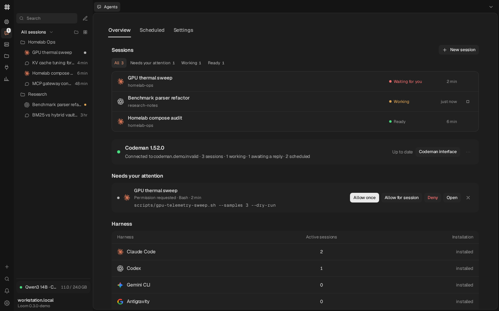
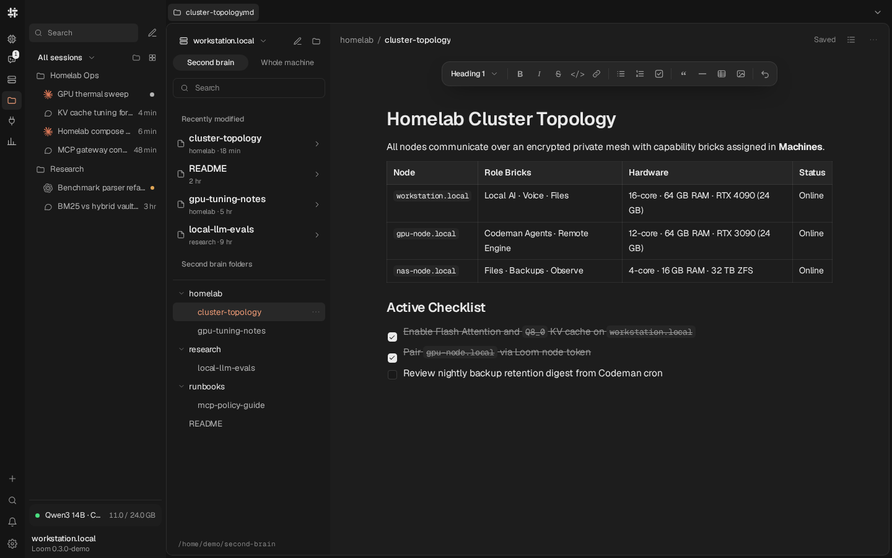
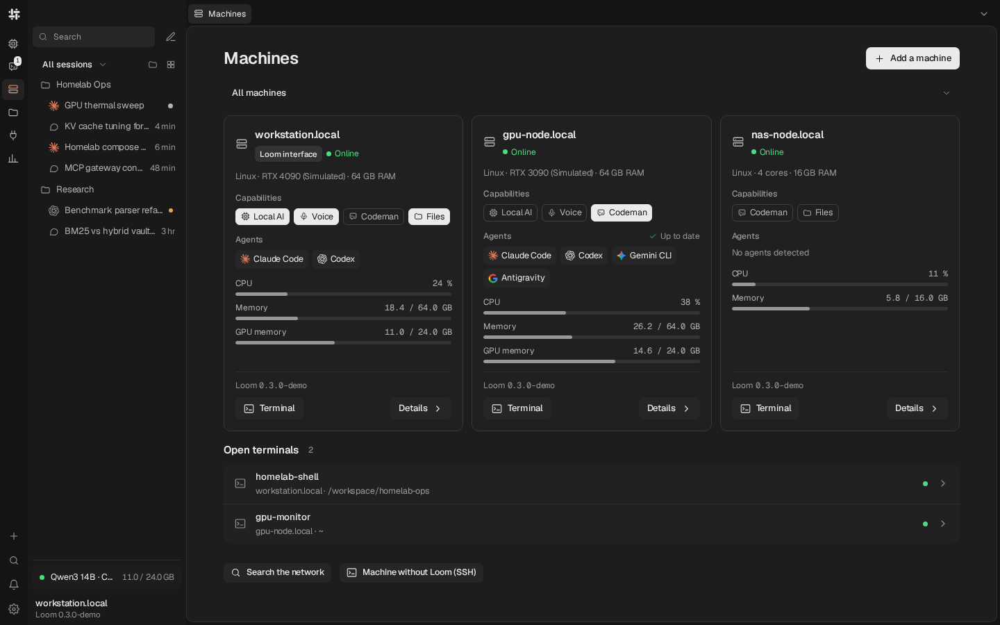
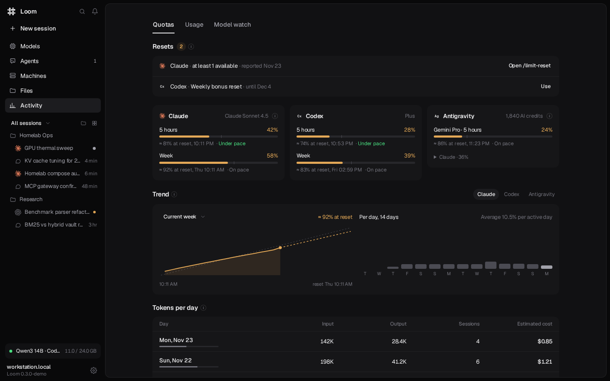
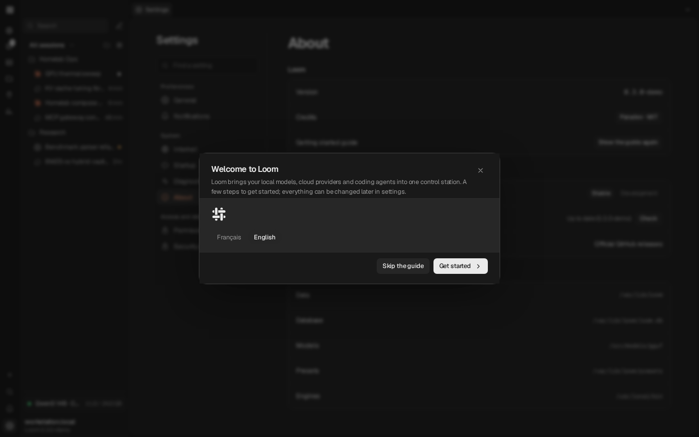
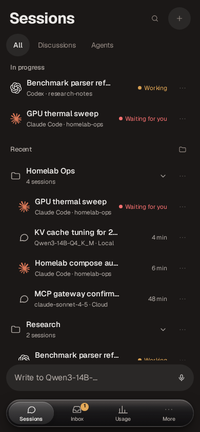

<div align="center">
  <picture>
    <source media="(prefers-color-scheme: dark)" srcset="docs/brand/loom-mark-light.svg" />
    
  </picture>
  <h1>Loom</h1>
  <p><strong>A local-first AI control station for local &amp; cloud models, Codeman coding agents, Second Brain notes, and homelab machines.</strong></p>
  <p>
    <a href="https://loom.lucas-homelab.fr">Website</a> ·
    <a href="https://demo.loom.lucas-homelab.fr">Live demo</a> ·
    <a href="https://docs.loom.lucas-homelab.fr/en/docs">Documentation</a> ·
    <a href="SECURITY.md">Security</a>
  </p>
  <p>
    <a href="LICENSE"></a>
    
    
  </p>
  
</div>

## Overview

Loom is a single self-hosted Go binary with an embedded web interface and installable mobile web app (PWA). It brings local inference (`llama.cpp` and `vLLM`), cloud Chat Completions providers, [Codeman](https://github.com/Ark0N/Codeman) coding-agent sessions, a Markdown Files workspace, multi-machine node management, local voice, and an authenticated MCP gateway into one calm, owner-controlled workspace.

- **Single session list**: switch between local or cloud models inside the same discussion, or drive Codeman agent sessions (Claude Code, Codex, Gemini CLI, Antigravity, OpenCode, Pi…) from the same folder-organized sidebar.
- **No forced cloud or telemetry**: binds to `127.0.0.1` by default, requires explicit confirmation before sharing portable conversation turns with any external provider, and keeps private reasoning blocks local.
- **Built for daily self-hosted operation**: single binary on Linux, macOS, and Windows (x86-64 and ARM64), native PTY/ConPTY terminals, multi-machine capability nodes, and a phone-first PWA.

## Product preview

All screenshots below are captured reproducibly from Loom's isolated, fictional [public demo](demo/README.md) ([capture manifest](docs/screenshots/manifest.json)).

<table>
  <tr>
    <td width="50%">
      <br />
      <sub><strong>Agents (Codeman)</strong> — Live sessions, approvals, harnesses, and schedules.</sub>
    </td>
    <td width="50%">
      <br />
      <sub><strong>Files (Second Brain)</strong> — Confined Markdown workspace with rich editor and node file browsing.</sub>
    </td>
  </tr>
  <tr>
    <td width="50%">
      <br />
      <sub><strong>Machines &amp; Nodes</strong> — Per-machine capability bricks (local AI, voice, Codeman, files, terminals).</sub>
    </td>
    <td width="50%">
      <br />
      <sub><strong>Activity &amp; Quotas</strong> — Usage tracking, multi-harness subscription quotas, and Model Watch.</sub>
    </td>
  </tr>
</table>

<details>
  <summary>More views: Local models, Engine router, Terminals, First-run guide, and Mobile PWA</summary>
  <br />
  <table>
    <tr>
      <td width="50%">
        <br />
        <sub><strong>Models</strong> — Hugging Face GGUF library, presets, and advisory VRAM estimator.</sub>
      </td>
      <td width="50%">
        <br />
        <sub><strong>Engine &amp; /v1 API</strong> — Router mode, parallel slots, idle VRAM unload, and named API keys.</sub>
      </td>
    </tr>
    <tr>
      <td width="50%">
        <br />
        <sub><strong>Terminals</strong> — Persistent PTY/ConPTY, SSH, and node terminals with WebGL rendering.</sub>
      </td>
      <td width="50%">
        <br />
        <sub><strong>First-run guide</strong> — Language, detected hardware, engine setup, or cloud-only start.</sub>
      </td>
    </tr>
    <tr>
      <td colspan="2" align="center">
        <br />
        <sub><strong>Mobile PWA</strong> — Bottom navigation (Sessions, Inbox, Usage, More) and one-tap agent approvals.</sub>
      </td>
    </tr>
  </table>
</details>

## Highlights

- **Local &amp; Cloud Discussions**: install, compile, or update `llama.cpp` and `vLLM` (CUDA/ROCm on Linux), link remote OpenAI-compatible servers or another Loom engine, and connect cloud Chat Completions providers in the same thread with explicit external-sharing confirmation.
- **Agents via Codeman**: manage an independent Codeman server from Loom — unified session list, WebGL + low-latency terminal (`xterm-zerolag-input`), tmux-style multi-pane grid, pending approvals, cron schedules, and reboot session recovery.
- **Files (Second Brain)**: confined `os.Root` Markdown workspace with a rich TipTap editor, slash commands, conflict detection, and remote file browsing across paired nodes.
- **Machines &amp; Nodes**: view each host as capability bricks (local AI, voice, Codeman, files, terminals, observation), pair remote machines with single-use codes via `loom node`, or connect over SSH.
- **Activity, Quotas &amp; Model Watch**: local and cloud token usage, multi-harness subscription quotas (Claude, Codex, Antigravity, Copilot) with pace projection, and Model Watch powered by OpenRouter and the Epoch Capabilities Index.
- **Voice (Jarvis) &amp; Mobile PWA**: optional local STT/TTS via `sherpa-onnx` with spoken profiles and built-in optional HTTPS (port `2543`), installable iPhone/Android PWA, and opt-in ntfy, webhook, and Web Push notifications.
- **Authenticated MCP Agent Access (`/mcp/loom`)**: expose controlled machine, overview, and Codeman MCP tools to external agents with revocable tokens, per-machine capability policies, and in-app bell/Inbox approvals.
- **OpenAI-Compatible `/v1` API**: stream-safe model swaps, background priorities, idle VRAM unload, and separate named `/v1` keys with usage limits.
- **English &amp; French UI**: English default with full French parity in Settings and the first-run guide.

## Quick start

### Install a published release binary

The installers verify `SHA256SUMS.txt` against official GitHub release assets. Review [install.sh](install.sh) or [install.ps1](install.ps1) before running.

Linux / macOS (requires root or `sudo` for system service setup):

```sh
curl -fsSL https://raw.githubusercontent.com/lucas-lepajollec/loom/main/install.sh | sh
```

Windows (PowerShell):

```powershell
irm https://raw.githubusercontent.com/lucas-lepajollec/loom/main/install.ps1 | iex
```

### Build and run from source

Requirements: Go `1.26.11+` and GNU Make (no Node build step is required for the embedded UI).

```sh
git clone https://github.com/lucas-lepajollec/loom.git
cd loom
make build
./bin/loom web 2510
```

Open [http://127.0.0.1:2510](http://127.0.0.1:2510) and follow the first-run guide to choose a language, review detected hardware, and install or link an engine (or continue with cloud providers only).

## Configuration and persistence

| Location / Variable | Purpose |
| --- | --- |
| `LOOM_HOME` | Data root containing `loom.db` (bbolt), `mcp.json`, presets, and encrypted secret stores. Defaults to `/etc/default/loom` when set, XDG / `~/.local/share/loom` on Unix, or `%ProgramData%\loom` on Windows. |
| `LOOM_HOME/secrets/providers/` | AES-256-GCM sealed cloud keys, Codeman credentials, node tokens, and HTTPS private keys (when not stored in the OS keychain). Back up `.key` and sealed files together privately. |
| `LOOM_TRUST_PROXY` | Opt-in (`1` / `true`) when running behind a local loopback TLS reverse proxy to honor `X-Forwarded-For` for login rate-limiting and `X-Forwarded-Proto: https` for `Secure` cookies. |
| `LOOM_COOKIE_SECURE` | Set to `1` behind TLS reverse proxies that do not forward `X-Forwarded-Proto`. |

- Run `loom where` to inspect resolved paths, `loom password` for local password recovery, and `loom edit` to inspect engine configuration.
- **Updates &amp; rollback**: update from **Settings → About → Updates** using checksum-verified GitHub release binaries with automatic retention of the previous binary; back up `LOOM_HOME` as a whole before upgrades or storage migrations. See [Updating Loom](docs/updates.md).

## Security, privacy, and limitations

- **Single-owner control plane**: Loom supervises local inference engines, terminals, paired nodes, and MCP tools with the OS user's authority. Run it as an ordinary user, never with unrestricted `sudo`.
- **Loopback-first by default**: binds to `127.0.0.1:2510` and refuses network exposure unless an access password (Argon2id, minimum 12 characters) or control key is configured. Anonymous loopback access requires both a loopback `Host` header and a direct loopback peer.
- **Hardened browser &amp; API boundaries**: strict `script-src 'self'` CSP with hashed importmap, `X-Frame-Options: DENY`, Go `http.NewCrossOriginProtection()` CSRF checks, `os.Root` file confinement, dial-time SSRF validation on web/push fetches, and instant (~1 s) revocation of terminal WebSockets and SSE streams on logout or credential rotation.
- **Explicit consent &amp; capability policy**: high-impact MCP gateway actions (`loom_machine_run`, `agents__start_session`) default to confirmation and enforce per-machine policy rules; local discussion tools also pass through capability policy.
- **Platform &amp; runtime limits**: release assets target Linux, macOS, and Windows (x86-64 and ARM64). Local `vLLM` requires Linux with NVIDIA CUDA or AMD ROCm (plus `uv` on AMD); local Voice requires Python 3; macOS tray icon builds require a C toolchain (`CGO_ENABLED=0` builds CLI + web UI without it).

See [SECURITY.md](SECURITY.md) for private vulnerability reporting and [Control plane review](docs/control-plane-audit.md) for audited boundaries.

## Architecture

| Layer | Implementation |
| --- | --- |
| Server &amp; Control Plane | Go `1.26+` (`cmd/loom`, `internal/loom`), `bbolt` transactional storage, Argon2id sessions, capability policy engine |
| Embedded Web UI &amp; PWA | Zero-build Preact + HTM ES modules (`internal/loom/ui/next`), TipTap editor, xterm.js + WebGL/`xterm-zerolag-input`, self-hosted Geist fonts |
| Inference &amp; Voice | Supervised `llama.cpp` / `vLLM` adapters, OpenAI `/v1` router, optional `sherpa-onnx` STT/TTS workers |
| Agents &amp; Nodes | Codeman HTTP/SSE/WebSocket gateway (`/api/codeman/*`), paired `loom node` workers, PTY/ConPTY/SSH terminals, `/mcp/loom` Streamable HTTP MCP gateway |

Internal reference docs: [Architecture](docs/architecture.md) · [Workspace contracts](docs/workspace-architecture.md) · [Engines](docs/engines.md) · [Terminals](docs/terminals.md) · [Files](docs/files.md) · [Agent access (MCP)](docs/agent-access.md) · [Policy](docs/policy.md) · [Voice](docs/voice.md) · [Notifications](docs/notifications.md)

## Development and quality

```sh
make build                                # Build ./bin/loom with embedded UI
make dev                                  # Run isolated development instance (127.0.0.1)
go test -race -short ./...                # Run Go test suite with race detector
go vet ./...                              # Static analysis
make check-ui                             # Run embedded UI & i18n unit tests (125 tests)
npm --prefix demo run check               # Validate isolated browser demo & fixtures
python3 tools/check-doc-links.py          # Verify local documentation & asset links
```

CI runs Go race tests, `go vet`, Windows/macOS cross-compilation, `govulncheck`, UI and demo checks, isolated Linux node install/rollback tests, 4 sharded Playwright Chromium + WebKit route crawls, Dependency Review, and CodeQL on every pull request.

## Public demo

Try Loom safely in your browser at **[demo.loom.lucas-homelab.fr](https://demo.loom.lucas-homelab.fr)** — a 100% client-side simulation of the real interface with fictional models, discussions, Codeman agent sessions, Second Brain notes, and nodes. No inference runs, no personal data or real hosts are used, and the **Reset** button restores the initial workspace at any time. See [demo/README.md](demo/README.md) to preview locally.

## Documentation and community

- [Website](https://loom.lucas-homelab.fr) · [Documentation](https://docs.loom.lucas-homelab.fr/en/docs) · [Live demo](https://demo.loom.lucas-homelab.fr)
- [Contributing](CONTRIBUTING.md) · [Support](SUPPORT.md) · [Security](SECURITY.md) · [Code of conduct](CODE_OF_CONDUCT.md) · [Changelog](CHANGELOG.md) · [Roadmap](docs/ROADMAP.md)

Released under the [MIT License](LICENSE).
