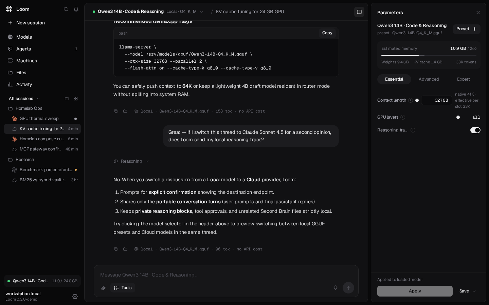
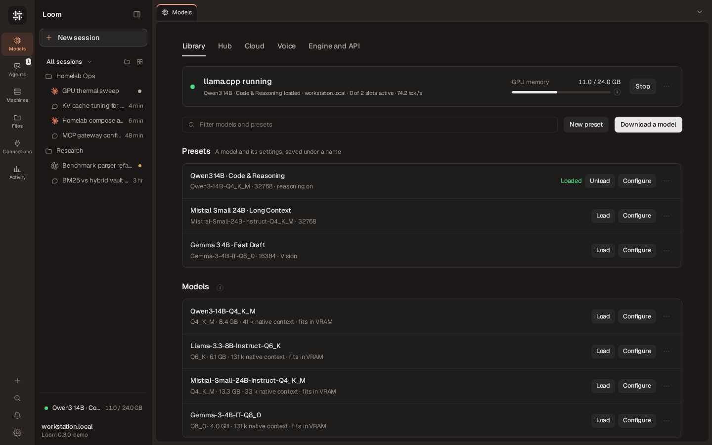
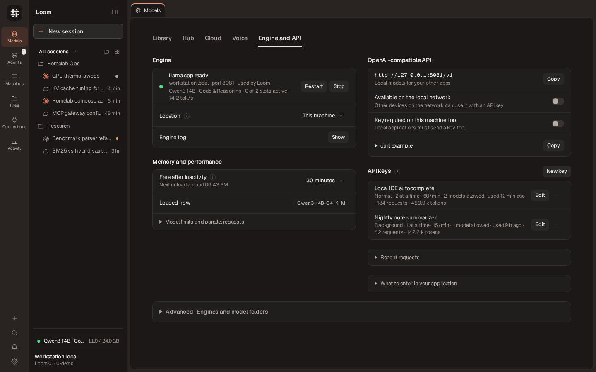
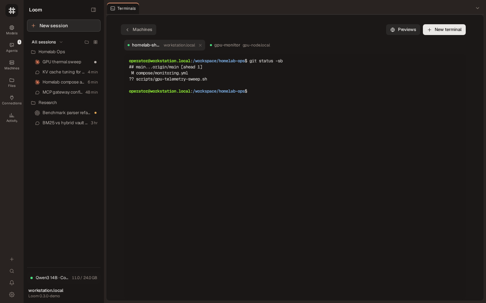

<div align="center">
  <picture>
    <source media="(prefers-color-scheme: dark)" srcset="docs/brand/loom-mark-light.svg" />
    
  </picture>
  <h1>Loom</h1>
  <p><strong>A local AI control station for local and cloud models and shared discussions.</strong></p>
  <p><a href="LICENSE">MIT license</a> · <a href="docs/ROADMAP.md">Roadmap</a> · <a href="CONTRIBUTING.md">Contributing</a></p>
  
</div>

Loom is a single Go binary with a web UI. Run local inference or connect cloud providers in the same discussion, and drive Codeman agent sessions from the same session list. A [Files page](docs/files.md) edits the folder your agents work in. The interface defaults to English; French is available in Settings and the first-run guide. On phones, Settings opens a section menu with a back link; model selection, model metrics and Environment tables adapt to the available screen width. The free [mobile layout audit](docs/mobile-layout-audit.md) documents checks at 390 px and 320 px and remaining browser acceptance.

Local speech management (Jarvis 6.1) uses sherpa-onnx 1.13.8 on this machine
or a paired node's `voice` module. It provides verified engine/model downloads,
curated packs, supervised STT/TTS, Doctor and a streaming API for browser voice.
Voice requires Python 3; missing catalog hashes refuse installation. See
[voice engine and API contracts](docs/voice.md). The Models › Voix UI is a
separate slice. Jarvis 6.2 adds isolated voice-session text streaming and optional
message-only injection into the originating discussion. Optional HTTPS on port
2543 shares Loom authentication and supports sealed self-signed or existing PEM
certificates for secure browser microphone access. The browser voice view is
built separately; exact API contracts are in the voice documentation.
Jarvis 6.3 adds a saved spoken profile (name, language, personality, length,
French formality and context), plus Jarvis-only TTS overrides. Idle engine
configuration changes restart resident speech workers. Kokoro/Piper deliver
audio after each native sentence batch; a single long sentence still waits for
synthesis, and the benchmark reports the measured first PCM separately.

## Why Loom

- Keep the discussion history when switching models.
- Manage engines, model libraries and parameters without rebuilding the inference stack.
- See tool permissions, usage and machine state in one workspace.
- Keep data locally and choose when to share it with an external destination.

## Models and engines

Install, compile or update **llama.cpp** from Loom, or link an existing binary. Engine updates also repair unhealthy builds at the current commit; the Engine page shows observed acceleration and offers **Rebuild** for unhealthy source installations. See [engine repairs](docs/engines.md#repairing-llamacpp-acceleration). Router mode keeps the engine running while models load through its API. Browse and download GGUF models from Hugging Face, save presets and tune per-model parameters with an advisory VRAM estimate.



Install **vLLM** in a Loom-managed Python environment on Linux with supported NVIDIA CUDA or AMD ROCm hardware. **Local** then switches between llama.cpp and vLLM: a Hugging Face model library, search with a VRAM estimate, downloads, per-model settings and start/stop; Settings › Engines handles install and idle updates. Drivers must already be installed; AMD installation requires `uv`.

Link a running **llama-server, vLLM or OpenAI-compatible server** by address, with no Loom installation required on that machine. Link **another Loom's engine** to manage its models and engine remotely. Direct server links provide inference; package and file management stay on the server's machine. See [engines](docs/engines.md).



**Cloud** connects Chat Completions-compatible providers, retrieves their model catalogs on request and controls model visibility. Keys can be remembered in the OS keychain. Catalog discovery does not guarantee that every listed model supports chat.

## Sessions and folders

Choose a Local or Cloud model for a discussion, or open an agent session on the
connected Codeman server. Folders group both kinds of sessions. A discussion
uses its own instructions and history. Moving it between folders does not send
folder metadata or files to a model. Archived agent transcripts remain readable.
See [workspace architecture](docs/workspace-architecture.md) and [migration](docs/harness-retirement.md).

## Memory and MCP

Loom keeps Markdown memory, discussion transcripts and background consolidation.
External clients can use the authenticated retrieval and memory tools at
`/mcp/brain` or the gateway at `/mcp/loom`. Configure each client manually.
See [memory and retrieval](docs/brain.md) and [MCP files](docs/mcp-files.md).

## Terminals

Open real terminals through **PTY** on Linux/macOS or **ConPTY** on Windows, locally, over SSH or through a paired node’s terminal module. Sessions survive closing a browser tab and replay recent output while Loom is running. See [terminals](docs/terminals.md).



## Usage, benchmarks and API

**Usage** separates retained Loom token counts, cloud balances where providers expose them. Missing values stay unknown; manual-price estimates are not invoices. See [usage and provider balances](docs/usage.md).

**Web search** connects DuckDuckGo, your own SearXNG, Brave Search or Tavily in
Settings › Internet. Local models retain Go/Crawl4AI page reading; cloud models
with function-call support can use the opt-in search tool. See [web search](docs/web-search.md).

**Bench** compares local engines and configured cloud APIs with the same prompt, without tools or project context. Results retain responses and distinguish engine timings from API observations. See [Bench](docs/bench.md). The **OpenAI-compatible `/v1` server** exposes `/v1/models` and `/v1/chat/completions` for other applications; local router requests use native slots and temporary parameter overrides without changing saved settings. [Engine service](docs/engines.md#engine-as-a-service) adds stream-safe model swaps, background priorities, idle VRAM unload and named API keys with limits and usage.

The UI also provides a **PWA** shell where the browser supports installation. HTTPS is required outside loopback. Offline mode shows a public fallback; it does not provide offline inference or queue messages.

API failures retain the last valid shared UI data and mark unavailable catalogs.
Mobile resume refreshes observations and reconnects discussion, terminal
and voice streams. See [UI data boundaries and recovery](docs/ui-data-boundaries.md)
for the contracts, regression checks and browser validation limits.

The notification service keeps model work and pending approvals running with every browser closed. Opt-in ntfy actions can answer an offered choice from a phone; webhooks and secure-context Web Push observe task events. All channels default off. See [notifications](docs/notifications.md) for setup and the event and settings APIs.

The phase 4b backend adds [central capability policy](docs/policy.md), canonical confirmations and a bounded audit, plus [Loom Doctor](docs/doctor.md), degraded feature fields and opt-in redacted support bundles. These documents include the exact API contracts for the separate Settings and Doctor UI work.

## Install

The installers download a matching GitHub release binary and verify `SHA256SUMS.txt`. They require published assets; if none are available, build from source. Linux/macOS installation also configures system services and requires root or `sudo`. Review [install.sh](install.sh) or [install.ps1](install.ps1) before running it.

Linux / macOS:

```sh
curl -fsSL https://raw.githubusercontent.com/lucas-lepajollec/loom/main/install.sh | sh
```

Windows (PowerShell):

```powershell
irm https://raw.githubusercontent.com/lucas-lepajollec/loom/main/install.ps1 | iex
```

To build from source, install Go 1.26.11+ and GNU Make. The web UI is embedded directly, with no Node build step. macOS's native menu-bar build also requires a C toolchain; `CGO_ENABLED=0` builds the CLI/web interface without that icon.

```sh
git clone https://github.com/lucas-lepajollec/loom.git
cd loom
make build
./bin/loom web 2510
```

Local inference needs an engine: install one from Loom or link an existing server. Compiling llama.cpp requires Git, CMake and a C/C++ toolchain.

## Quick start

1. Run `loom web 2510` (or `./bin/loom web 2510` after a source build).
2. Open [http://localhost:2510](http://localhost:2510).
3. Follow the first-run guide: choose a language, review detected hardware, choose the default workspace, install or link an engine, or continue with cloud only. The llama.cpp path offers a first GGUF model sized to available memory; vLLM models are managed in **Local**.
4. Create a discussion and choose its execution target. Confirm external sharing when prompted. Use folders to organize the session list.

Reopen the guide from **Settings › About**. The guide currently offers vLLM only on detected Linux/NVIDIA systems; supported AMD/ROCm setups install it from **Settings › Engines**.


## Development previews

To test the current checkout on a phone before a release, use `make dev` with
isolated development data, then `make dev DEV_HOST=<computer-LAN-address>` after
setting a development access password. Restart the command and reload after
source edits; no commit or release is required. See [phone testing](CONTRIBUTING.md#test-uncommitted-changes-from-a-phone).

**Terminals › Application previews** opens an HTTP development server on Loom or a saved SSH machine, including assets and WebSocket/HMR, through a separate authenticated browser origin. VM clients must be able to reach the preview listener; HTTPS setups need a separate preview origin. See [development previews](docs/development-previews.md).

## Configuration

- Use **Settings** for engines, machines, network access, vault, snapshots and language; use **Cloud** and **Agents** for their connections.
- `loom where` shows resolved paths; `loom edit` edits engine configuration. `LOOM_HOME` selects the data root. Defaults follow `/etc/default/loom` when present, then XDG/`~/.local/share/loom` on Unix; Windows uses `%ProgramData%\loom` with platform fallbacks.
- Configuration, discussions and preferences live in `LOOM_HOME/loom.db`. Models can live in selected external folders. MCP definitions live in editable `LOOM_HOME/mcp.json`; see [MCP files](docs/mcp-files.md).
- `.env.local` and `.env` in the current working directory fill unset variables; exported values take precedence. Keep local development data in ignored `.project-local/`.

## Platform support

Release assets target x86-64 and ARM64 on all three platforms. Availability is separate from real-platform acceptance; consult the [roadmap](docs/ROADMAP.md) for remaining checks.

| Capability | Linux | macOS | Windows |
| --- | --- | --- | --- |
| Loom CLI and web UI | Yes | Yes | Yes |
| Local llama.cpp | Yes, backend-dependent CPU/GPU support | Yes, including Metal where supported | Yes, backend-dependent CPU/GPU support |
| Local vLLM | Supported NVIDIA CUDA / AMD ROCm GPUs only | Link a remote server | Link a remote server |
| Local terminals | PTY | PTY | ConPTY: Windows 10 1809+ / Windows 11 |
| SSH machines and remote engines | Yes, with SSH client f/terminals | Yes, with SSH client f/terminals | Yes, with SSH client f/terminals |

Harness availability also depends on the native CLI, adapter launcher, account and upstream OS requirements.

## Privacy and security

Loom binds to loopback by default and adds no telemetry. Local model inference and BM25 search stay on the machine running their engine. Discussions and project definitions are stored in Loom's data directory.

External selection requires confirmation before sharing the portable transcript and selected context. A cloud provider receives that text; a remote engine receives inference requests. Shared text can include earlier replies. Private reasoning, approvals and tool state do not become portable context.

The Agents page reports per-capability discovery, free protocol verification and
observed success from normal sessions. Accepted versions alone never claim a
capability works. Installed engines and providers keep their own execution limits.

Network access also occurs for requested model/catalog downloads, installs, updates, account reads, service checks and enabled tools/MCP servers. Engine update settings are separate. Cloud semantic indexing sends selected source text and search queries after stored consent; remote distillation requires consent before sending discussion text.

Set an **access password** in Settings → Security and data to sign in from other devices. The browser uses an HttpOnly session cookie; no control key needs to be copied between devices. Existing control keys remain supported for automation and remote-engine links, separately from the `/v1` inference key. Network exposure requires a password or existing control key; use TLS for remote access. See [Interface access](docs/access.md) for migration, password changes and local recovery with `loom password`. The optional **vault** encrypts supported Loom stores and blocks access while locked. Cloud provider keys remain in memory unless explicitly remembered in the **OS keychain or encrypted server store**; they are not stored in provider records or browser storage. External files retain their own security rules. See [SECURITY.md](SECURITY.md).

Update Loom from **Settings → About → Updates** using official GitHub releases, verified checksums and a retained previous binary. Linux system installations support a scoped updater and UI restart after one-time administrator setup; see [Updating Loom](docs/updates.md). A source push becomes available to installed users only after a release is published.


## Documentation

- [Engines and vLLM](docs/engines.md) · [Terminals](docs/terminals.md)
- [Workspaces and native access](docs/workspaces.md) · [Development previews](docs/development-previews.md)
- [Brain and context](docs/brain.md) · [MCP files](docs/mcp-files.md)
- [Provider balances](docs/usage.md)
- [Interface languages](docs/i18n.md)
- [Architecture principles](docs/architecture-principles.md) · [Architecture](docs/architecture.md) · [Workspace contracts](docs/workspace-architecture.md)
- [Product vision](docs/VISION.md) · [Roadmap](docs/ROADMAP.md) · [Changelog](CHANGELOG.md)
- [Browser demo setup](demo/README.md) — a fictional simulation, without inference

## Contributing and license

The runtime registry contains Local and Cloud adapters only. Generic tools,
policy and retained display events remain separate from inference protocols.
